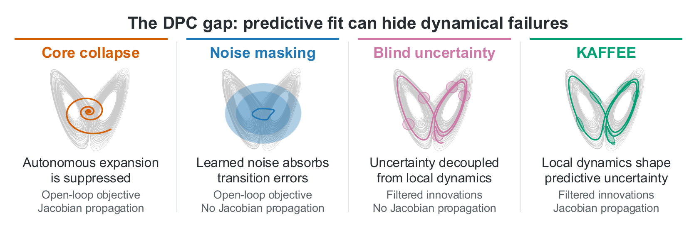
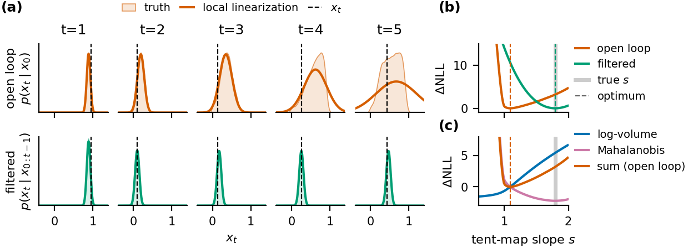

# The Dynamic-Probabilistic Consistency Gap in Chaotic Surrogate Modeling (NeurIPS 2026)

This repository contains Python/PyTorch implementations accompanying our paper:

**[The Dynamic-Probabilistic Consistency Gap in Chaotic Surrogate Modeling](https://arxiv.org/abs/2605.31547)**  
**Published in the Main Track of NeurIPS 2026**

## Background

Dynamical systems reconstruction (DSR) aims to learn models that reproduce the dynamics underlying observed time series. Using these models as reliable scientific tools requires meaningful uncertainty estimates. However, the (approximate) probabilistic objectives that these models are trained on are not necessarily aligned with high fidelity of the reconstructed dynamics. Rather, training can degrade autonomous behavior of the model, misinterpret model errors as noise, or disconnect uncertainty from the learned local dynamics. We call this the **dynamic-probabilistic consistency (DPC) gap**.

We introduce **KAFFEE (Kalman-Aware Framework For Ergodic Emulation)** as a modeling principle that combines filtered objectives (in the paper, instantiated through differentiable extended Kalman filtering) with uncertainty propagation that is tied to the learned transition Jacobians. We initialize the transition dynamics via pretrained deterministic models. In training, each observation is scored before it is assimilated. The Kalman update then corrects the latent state, while the covariance adheres to the learned local dynamics. We show that this yields an improved balance between predictive fit and reconstruction of underlying autonomous dynamics.



*The DPC gap and KAFFEE. Gray curves show reference dynamics, colored curves show learned dynamics, and shading illustrates predictive uncertainty.*

### An illustrative example



**Improving a probabilistic objective can favor the wrong dynamics.** Shown on the chaotic tent map, whose slope s controls how quickly nearby states separate on average.

- **(a)** Without using new observations ("open loop"), the uncertainty approximation becomes inaccurate. Updating the state and its uncertainty after each observation ("filtered") keeps the predicted spread close to the true one.
- **(b)** Pursuing a higher likelihood lets the open-loop objective learn a slope that is too small, while the filtered optimum is very close to the true value.
- **(c)** The log-determinant penalty for uncertainty spread ("log-volume") pulls the open-loop optimum toward weaker expansion, despite the opposing data-fit ("Mahalanobis") term in the negative log-likelihood objective.

## 1. Setup and usage

### Installation

The repo uses **Python 3.11** or newer and **PyTorch 2.12 or newer**. To clone the repo and install it in a virtual environment (venv), run:

```bash
git clone https://github.com/aherz/kaffee-dpc.git
cd kaffee-dpc
python -m venv .venv
source .venv/bin/activate
python -m pip install -e .
```

For some of our experiments, the installation needs the dynamical-systems foundation model [DynaMix](https://github.com/DurstewitzLab/DynaMix-python). Package dependencies are in [pyproject.toml](pyproject.toml) and [requirements.txt](requirements.txt). To install fixed versions of the main numerical packages, use `python -m pip install -r requirements.txt -e .`.

Code execution supports CPU and CUDA GPUs. The evaluation examples use `--device auto`. Using this selects CUDA when available, otherwise CPU.

### Included data and trained models

The repo includes the used Lorenz-96 and Lorenz-63 datasets and references for evaluation, five standardized EEG recordings from the [PhysioNet dataset](https://physionet.org/content/eegmmidb/), the DynaMix base model, and all trained models used in the paper.

Each experiment's configuration can be found in `configs/`, and the corresponding results in `results/<experiment>/tables/`.

### Quick first look

An exploratory example on data from the Lorenz-63 system can be found in [l63_example](notebooks/l63_example.ipynb).

## 2. Code overview

### Dynamical cores and stochastic shells

The state-space models used combine a deterministic latent transition (the deterministic "core") with process and observation noise (the stochastic "shell"):

$$z_{t+1}=F_{\theta_c}(z_t)+\varepsilon_t,\qquad x_t=Bz_t+\eta_t.$$

The shells learn diagonal process and observation covariances. KAFFEE's EKF propagates the latent covariance using the local transition Jacobian:

$$\Sigma_{t+1\mid t}=J_t\Sigma_{t\mid t}J_t^\top+\Gamma.$$

The implementations are organized as follows:

| Component | Implementation |
| --- | --- |
| Almost-linear RNN (AL-RNN) | [alrnn.py](src/models/alrnn.py) |
| Dense and rank-reduced AL-RNN shells | [alrnn_shell.py](src/models/alrnn_shell.py), [alrnn_shell_lr.py](src/models/alrnn_shell_lr.py) |
| DynaMix integration and shell | [dynamix.py](src/models/dynamix.py), [dynamix_shell.py](src/models/dynamix_shell.py) |
| Clipped shallow PLRNN and shell | [shplrnn.py](src/models/shplrnn.py), [shplrnn_shell.py](src/models/shplrnn_shell.py) |
| Dense and rank-reduced filtering | [ekf.py](src/filtering/ekf.py), [ekf_lr.py](src/filtering/ekf_lr.py) |
| Filtered and open-loop objectives | [objectives.py](src/filtering/objectives.py) |
| Training and experiment pipelines | [training/](src/training/), [experiments/](src/experiments/) |

The probabilistic controls vary training objective and covariance propagation:

| Method key | Training objective | Covariance propagation | Core learned? |
| --- | --- | --- | --- |
| `kaffee` | Filtered innovation NLL | Local Jacobian | Yes |
| `frozen_core_shell` | Filtered innovation NLL | Local Jacobian | No |
| `filtered_no_propagation` | Filtered innovation NLL | Identity | Yes |
| `open_loop_tied` | Open-loop Gaussian NLL | Local Jacobian | Yes |
| `open_loop_no_propagation` | Open-loop Gaussian NLL | Identity | Yes |

### Evaluation and visualization

The three-axis evaluation protocol we propose for probabilistic DSR in the paper separates local predictive quality, reconstruction of long-term deterministic dynamics, and reconstruction of long-term stochastic dynamics. Implementations of the metrics used are in [src/metrics/](src/metrics/).

To render paper figures from the saved inputs, without retraining or recomputing trajectories, use e.g.:

```bash
python scripts/run_l96_main_figure.py --plot-only --figure-dir scratch/figures/l96_main
```

This will write the figure inside `scratch/`. Using `--plot-only` lets the figure scripts render the figures from saved inputs without generating new evaluation data.

## 3. Running experiments

### Lorenz-96 and Lorenz-63

Both of these experiments use almost-linear RNNs ([AL-RNNs](https://github.com/DurstewitzLab/ALRNN-DSR)) as pretrained deterministic cores. To evaluate the deterministic core and probabilistic shell models used in the paper, run:

```bash
python scripts/run_l96_full.py --mode use-checkpoints \
  --output-root scratch/l96_evaluation --device auto --cpu-threads 1

python scripts/run_l63_full.py --mode use-checkpoints \
  --output-root scratch/l63_evaluation --device auto --cpu-threads 1
```

There are three different modes supported for these scripts:

| Mode | Function |
| --- | --- |
| `use-checkpoints` | Load the supplied cores and shells and re-evaluate them. |
| `train-shells` | Start from pretrained cores, train the probabilistic models, then evaluate. |
| `from-scratch` | Train deterministic cores, fit the probabilistic models using these cores, then evaluate. |

For example, to train KAFFEE on two pretrained Lorenz-96 cores:

```bash
python scripts/run_l96_full.py --mode train-shells --baselines kaffee \
  --max-seeds 2 --output-root scratch/l96_training --device auto --cpu-threads 1
```

New checkpoints are written in `cores/` and/or `shells/`, and results in `tables/`. To evaluate a newly trained run:

```bash
python scripts/run_l96_full.py --mode use-checkpoints --baselines kaffee \
  --max-seeds 2 --shell-source-root scratch/l96_training/shells \
  --output-root scratch/l96_eval --device auto --cpu-threads 1
```

When re-evaluating a `from-scratch` run, also set `--core-source-root` to that run's `cores/` directory.


### DynaMix adaptation

Here we train the probabilistic shells in-context using the pretrained dynamical-systems foundation model [DynaMix](https://github.com/DurstewitzLab/DynaMix-python). The model weights are in [models/dynamix_base/](models/dynamix_base/), trained models are in [models/dynamix_main_shells/](models/dynamix_main_shells/).

To regenerate the data from the 13 used chaotic systems and recompute the metrics from the trained shells, run:

```bash
python scripts/run_dynamix_full.py --mode use-checkpoints \
  --output-root scratch/dynamix_evaluation --device auto --cpu-threads 1
```
This full experiment covers five probabilistic adaptation methods, 13 systems, and 20 seeds.

Use `--mode adapt` with a new output root to train and evaluate new shells, and use `--systems`, `--baselines`, and `--max-seeds` to limit the run to specific systems, methods or to a certain number of seeds.

### Rank-reduced KAFFEE

KAFFEE's rank-reduced variant (rr-KAFFEE) uses a low-rank covariance factor and truncated SVD. It also learns a low-rank process-noise factor, whereas normal ("dense") KAFFEE uses diagonal process noise.

For example, to evaluate the supplied rank-20 models:

```bash
python scripts/run_l96_full.py --config configs/lorenz96_rrkf.json \
  --mode use-checkpoints --filter-rank 20 --baselines kaffee \
  --shell-source-root models/lorenz96_rrkf_shells/r020 \
  --output-root scratch/rrkf_r020 --device auto --cpu-threads 1
```

To check another rank, change `--filter-rank` and the directory (`r005`, `r010`, `r020`, `r040`, or `r080`). 

### EEG reconstruction

The EEG experiment uses pretrained clipped shallow piecewise-linear RNNs (shPLRNNs), following [GTF-shPLRNN](https://github.com/DurstewitzLab/GTF-shPLRNN). The five EEG recordings are from the [PhysioNet EEG Motor Movement/Imagery Dataset](https://physionet.org/content/eegmmidb/). The standardized data we train on is in [src/data/eeg/](src/data/eeg/).

Released pretrained cores are in [models/eeg_main_cores/](models/eeg_main_cores/) and probabilistic shells in [models/eeg_main_shells/](models/eeg_main_shells/). The experiment can be re-run using e.g.:


```bash
python scripts/run_eeg_full.py --mode use-checkpoints \
  --output-root scratch/eeg_evaluation --device auto --cpu-threads 1
```

The modes (`use-checkpoints`, `train-shells`, `from-scratch`) are the same as for the Lorenz-96 and Lorenz-63 experiments.

## Citation

If you find the paper or code useful for your research, please cite:

```bibtex
@inproceedings{herz2026dpc,
  title     = {The Dynamic-Probabilistic Consistency Gap in Chaotic Surrogate Modeling},
  author    = {Herz, Andre and Pals, Matthijs and Durstewitz, Daniel and Koppe, Georgia},
  booktitle = {Advances in Neural Information Processing Systems},
  year      = {2026},
  url       = {https://arxiv.org/abs/2605.31547}
}
```

Please also cite the original model/method papers when using
[AL-RNNs](https://github.com/DurstewitzLab/ALRNN-DSR),
[DynaMix](https://github.com/DurstewitzLab/DynaMix-python), or
[Generalized Teacher Forcing / shPLRNNs](https://github.com/DurstewitzLab/GTF-shPLRNN). For the EEG recordings, attribution requirements are on the [PhysioNet dataset homepage](https://physionet.org/content/eegmmidb/).

## License

This code is released under the [GNU General Public License v3.0](LICENSE) (GPLv3).

The AL-RNN and shPLRNN implementations follow [ALRNN-DSR](https://github.com/DurstewitzLab/ALRNN-DSR) and [GTF-shPLRNN](https://github.com/DurstewitzLab/GTF-shPLRNN), both released under GPLv3. The [DynaMix code](https://github.com/DurstewitzLab/DynaMix-python) is also released under GPLv3. The [DynaMix base model](https://huggingface.co/DurstewitzLab/dynamix) is provided under [CC BY 4.0](https://creativecommons.org/licenses/by/4.0/).
The five standardized EEG recordings are from the PhysioNet [EEG Motor Movement/Imagery Dataset](https://doi.org/10.13026/C28G6P), version 1.0.0, distributed under the [Open Data Commons Attribution License v1.0](https://physionet.org/content/eegmmidb/view-license/1.0.0/) (ODC-By).
